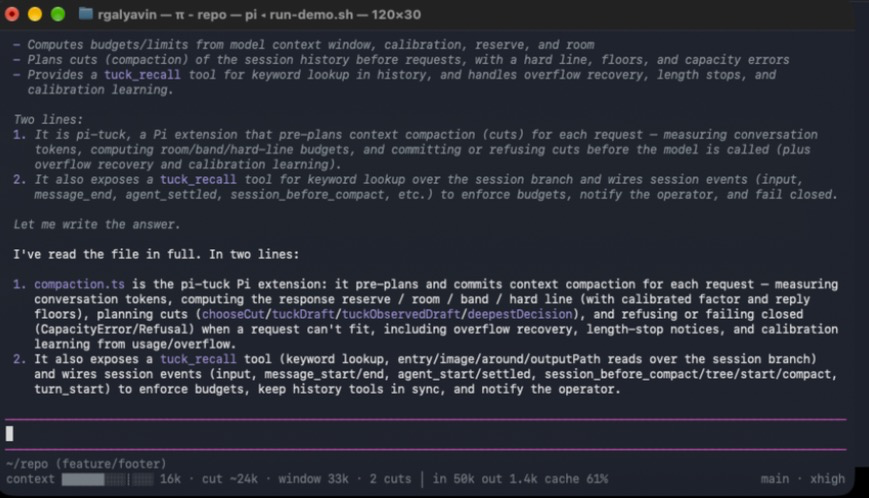

# pi-tuck

pi-tuck is an extension for [Pi](https://pi.dev). It builds deterministic compaction summaries from the saved session without calling a model. After a cut, the agent can look up original text and tool results on the current branch.

## Install

Use Pi 1.2.0 or later and Node.js 22.19.0 or later on macOS, Linux, or Windows.

```sh
pi install npm:pi-tuck
```

Start a new Pi process after installing or updating. pi-tuck handles automatic compaction and `/compact` by default. Run `/tuck` to see the loaded version, cut history, and active cut policy.

This README describes pi-tuck 1.5.0. To pin a published release, use a versioned source such as `pi install npm:pi-tuck@1.5.0` or `pi install git:github.com/galyavin/pi-tuck@v1.5.0`. To uninstall, run `pi remove` with the source you installed.

## Compaction and recall

A cut replaces older turns in the model's context with a summary while keeping the original entries in the session. The summary prioritizes the current prompt, recent turns, excerpts from earlier prompts, and pointers to files and tool actions. It can also carry recent reads and searches when the session records no action that could have changed their files. The recorded text is historical evidence about the session. Re-read a file before editing it.

When pi-tuck is active, `tuck_recall` becomes available after a cut on the current branch. Use a keyword query to locate a passage.

```json
{ "query": "retry token refresh" }
```

Read the original by the hit's `entryId`, or use `{"index": 212}` to follow a `#212` reference in the summary. Pass a search result's `next` value as `continuation` to get the next page. Page long sources with `offset` and `limit` in UTF-16 characters. Use `outputPath` with an `entryId` or `index` to export eligible text through Pi's `write` tool. Recall excludes hidden reasoning and system records.

| Command | Purpose |
|---|---|
| `/compact` | Request a cut. pi-tuck builds the summary from the session and ignores any appended instructions. |
| `/tuck` | Inspect the loaded version, saved cuts, and cut point. |
| `/tuck-incident on\|next\|off\|status` | Control diagnostic recording. The default directory is `~/.local/state/pi-tuck-incidents`. |

Pi-tuck needs a supported Pi version and a nonvirtual model with a valid context window. Setting `"compaction": { "enabled": false }` in Pi's settings disables automatic compaction and makes pi-tuck stand down, including for `/compact` and recall. `/tuck` reports why a loaded compactor is standing down. Capacity notices go to stderr in headless runs.

## Footer

In Pi's terminal UI, pi-tuck replaces Pi's footer. The gauge shows the context against the window, and `┊` marks pi-tuck's cut point, the number `/tuck` reports. The line also shows the cut count, Pi's token and cost totals, the model and thinking level, the folder and git branch, and other extensions' statuses. The gauge turns yellow as the context nears the cut point. In a narrow terminal the line shortens to the gauge, the context size over the cut point, and the cut count. Right after a cut, before the next reply, the size is the cut's own estimate, shown with `~`.



When pi-tuck stops a request or a reply ends at its length limit, the notice suggests `/tuck-incident next` to record the next cut for a bug report.

## Settings

Optional settings go in `pi-tuck.json` in Pi's agent directory (`~/.pi/agent` by default, or `PI_CODING_AGENT_DIR`). Restart Pi to apply changes. The input room starts at the model's context window minus Pi's `compaction.reserveTokens`. Invalid JSON uses defaults. An invalid field uses its own default, with a notice when compaction is active.

- **`cutAt`** is a fraction above 0 and at most 1. By default pi-tuck cuts at the room, less a 2% margin. An explicit value fixes a fraction of the room, subject to the same margin even at `1`.
- **`cacheSensitiveModels`** lists exact `provider/model` identifiers. For these models, the cut point is the full room, taking precedence over `cutAt`. This delays early cuts that would discard a reusable prompt prefix.
- **`footer`** set to `false` keeps Pi's own footer.
- **`llamaContinuation`** opts one reasoning model into a single extra request after a thinking-only response exhausts the full configured output allowance. In Pi's `models.json`, configure that model on a llama.cpp provider using the `openai-completions` API. Verify that the runtime and template support `continue_final_message: "reasoning_content"` and report reused prompt tokens through `prompt_progress`. Pi-tuck requires the first cache report to match the prefix within 15 seconds. The positive integer `extraTokens` caps the additional allowance within the remaining context. The positive integer `deadlineMs` covers both requests.

```json
{
  "cacheSensitiveModels": ["my-provider/my-model"],
  "llamaContinuation": {
    "model": "my-provider/my-model",
    "extraTokens": 4096,
    "deadlineMs": 5400000
  }
}
```

## Output exhaustion and small windows

- Pi-tuck preserves thinking-only stops in session history. At the model's full output allowance, it reports exhaustion if the reply remains unfinished. Below that allowance, it retries once, re-armed as Pi's overflow recovery is.
- Pi-tuck uses the context window declared in Pi's model configuration. A length stop alone does not establish a smaller window. If the server has a smaller effective limit, set that limit in Pi's model configuration.
- Pi's compaction reserve sets the cut target. For larger requests, pi-tuck estimates reply needs from observed output on the current branch for the active model, bounded by the reserve and model output limit. A cut above the room aims to leave 3,584 reply tokens within those bounds; where no cut can, the request goes out as before. If cuts cannot leave enough room for the protected prompt and a reply, try a shorter prompt, fewer tools, or a larger window. Pi-tuck's checks use estimates. Pi handles recognized provider overflows, and silent truncation can go undetected.

When using OpenRouter, you can pin an upstream in Pi's `models.json` if upstreams count context differently.

```json
{ "providers": { "openrouter": { "compat": { "openRouterRouting": { "only": ["your-upstream"], "allow_fallbacks": false } } } } }
```

See [Small windows](docs/small-windows.md) for the current budgeting policy and the [proposed Pi request contract](docs/pi-request-boundary.md) for the limits on final request admission and retry coordination.

## Use from code

Hosts that embed Pi through its SDK can import the compactor directly.

```ts
import { installCompaction } from "pi-tuck";

const handle = await installCompaction(pi);
```

Use `hostMessages` for context the host injects, `requestReserve` for a host reply budget, and `recallPolicy` to restrict recall. Set `responseExact: true` in the reserve result to use the declared value. By default a host reserve is at least the model's configured output limit. Call `await handle.close()` before disposing the session to stop the incident recorder. [SDK options](src/compaction.ts)

## Development

From the repository root, install the locked dependencies and run the checks.

```sh
npm ci
npm run build
npm run check
npm test
```

The build emits the SDK in `dist/` and refreshes the tracked `src/build-id.ts`. Include the refreshed ID when committing changes to `index.ts` or `src/`. To run one file, use `npm test -- test/llama-continuation.test.ts`. To load this checkout for one Pi invocation, run `pi --no-extensions -e ./index.ts` from the repository root.

- The extension entry point reads settings and registers the optional provider adapter. [Entry point](index.ts) · [Continuation adapter](src/llama-continuation.ts)
- Session hooks plan cuts for Pi to commit. [Compaction hooks](src/compaction.ts) · [Reply budgeting and Pi's clamp](src/request-capacity.ts)
- The summary compiler renders the cut. Recall reads eligible source entries from the branch. [Summary compiler](src/tuck.ts) · [Recall](src/recall.ts)

See [Contributing](CONTRIBUTING.md) for stress tests and [the changelog](CHANGELOG.md) for release changes.

## Benchmarks

- **128k live run.** pi-tuck 1.0.1 resolved 258 of 300 SWE-bench Verified tasks versus Pi's 251. Median completed cuts took 0.081 s (an upper bound from session timestamps) versus 235.3 s with a local summarizer. The one-sided 95% lower bound on the resolution difference fell from +0.3 to −0.4 points when the chain with 44 Pi compaction failures was excluded. [128k results](benchmark/RESULTS-MAIN.md)
- **128k recall replay.** Completed answer sets at cuts 1–4 supported the registered 3-point margin against Pi's summaries and kept messages. The scoring excluded 52 of 95 pi-tuck sets that aborted. [Retention results](benchmark/RESULTS-MAIN.md)
- **32k live run.** pi-tuck 1.0.5 resolved 120 of 150 tasks versus Pi's 94 and observation masking's 117. The one-sided 95% lower bounds were +10.7 and −2.7 points, respectively. pi-tuck recorded one dead task against a target of zero. [32k results](benchmark/RESULTS-32K-ACCEPT.md)

The [benchmark index](benchmark/README.md) records the models, versions, plans, and scope of each result.

## Credits and license

MIT. pi-tuck grew out of [pi-vcc](https://github.com/sting8k/pi-vcc) and includes code from [pi-blackhole](https://github.com/k0valik/pi-blackhole) and [Pi](https://github.com/earendil-works/pi). See [NOTICE](NOTICE).
